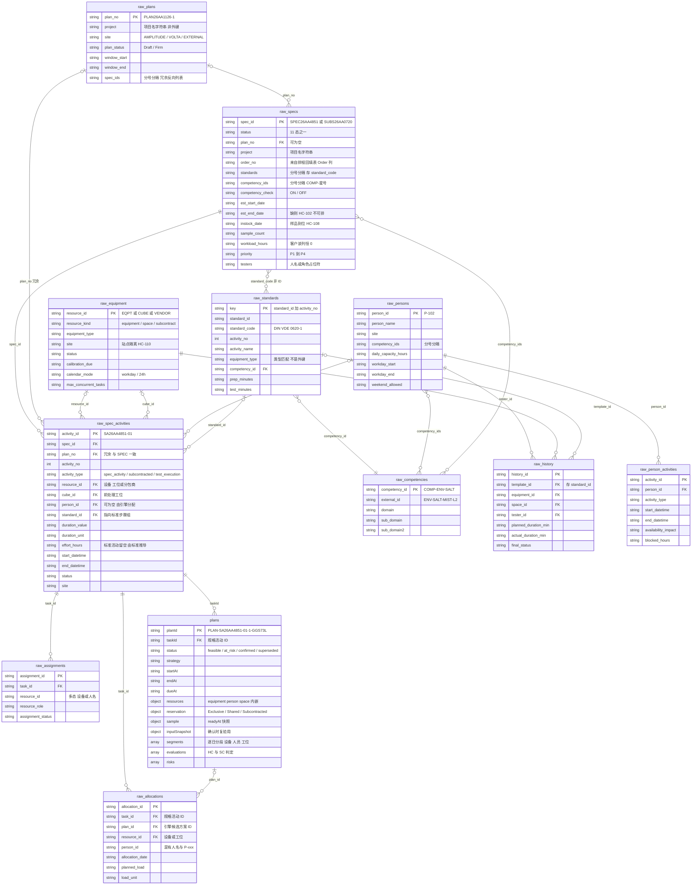
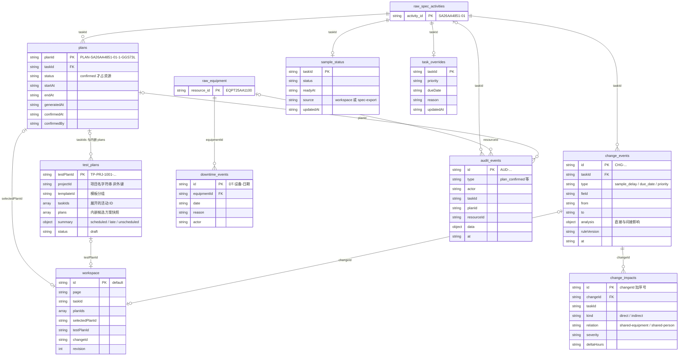

# Agentic LIMS MongoDB 结构与 ER 图

> 快照：2026-10-30 11:03（演示时钟冻结 2026-10-30 08:00）
> 实例：`mongodb://127.0.0.1:27018` / 库 `agentic_lims`
> 口径：直接读当前库的集合、字段与引用值，并与 `agentic-lims/lib/model.js` 的投影逻辑核对。

## 1. 三层结构

| 层 | 集合 | 写入方式 | 作用 |
|---|---|---|---|
| 原始层 | `raw_*` | 启动时从 `agentic-lims/data/*.csv` 原样导入 | 客户导出的系统记录，**所有标量都是字符串**；改数据不改这里 |
| 规则层 | `lab_rules` | 单例文档，`_id = lab-rules-v1` | 11 态状态机、预约模式、能力项、日历、优先级词表、工时回退；全部 `confirmed: false` |
| 运行时层 | `plans` / `test_plans` / `audit_events` / `change_events` / `change_impacts` / `sample_status` / `task_overrides` / `downtime_events` / `workspace` / `meta` | 业务动作追加写 | 候选方案、测试计划、审计、变更影响、工作区状态 |

**不落库的派生对象**：`task`（= 可排的规格活动投影）、`Project`、`Order`、周计划、甘特、`test_execution` 行。  
所以库里没有 `projects` / `orders` / `tasks` 集合；`taskId` 在运行时集合里就是 `raw_spec_activities.activity_id`。

## 2. 集合清单（当前条数）

| 集合 | 条数 | 主键 `_id` | 说明 |
|---|---:|---|---|
| `raw_specs` | 19 | `spec_id` | SPEC 主数据（11 态、计划窗口、样品到位） |
| `raw_spec_activities` | 17 | `activity_id` | 13 `spec_activity` + 2 `subcontracted` + 2 `test_execution` |
| `raw_plans` | 4 | `plan_no` | 客户 PLAN 批次（PLAN26AA…-1） |
| `raw_standards` | 9 | `standard_id#activity_no` | 一个标准拆多行步骤，**主键是复合键** |
| `raw_competencies` | 8 | `competency_id` | 能力项目录 |
| `raw_equipment` | 9 | `resource_id` | 6 设备 + 2 工位 + 1 分包商 |
| `raw_persons` | 5 | `person_id` | 人员、站点、能力项、日历 |
| `raw_allocations` | 14 | `allocation_id` | 既有占用（设备小时 / 人员工时） |
| `raw_assignments` | 3 | `assignment_id` | 资源分配记录 |
| `raw_history` | 7 | `history_id` | 历史实际时长（工时回退来源） |
| `raw_person_activities` | 3 | `activity_id` | 培训 / 审核等人员占用 |
| `raw_constraints` | 18 | `constraint_id` | 规则目录，无外键，靠 `constraint_id` 被评估结果引用 |
| `lab_rules` | 1 | `lab-rules-v1` | 规则单例 |
| `plans` | 11 | `planId` | 候选方案；`superseded 6 / confirmed 3 / feasible 1 / at_risk 1` |
| `test_plans` | 0 | `testPlanId` | 项目级测试计划 |
| `audit_events` | 12 | `id` | 追加式审计 |
| `change_events` | 0 | `id` | 变更事件（样品 / 交期 / 优先级） |
| `change_impacts` | 0 | `changeId-index` | 变更影响行，随事件写入 |
| `sample_status` | 0 | `taskId` | 只在样品变更时写，覆盖 `instock_date` |
| `task_overrides` | 0 | `taskId` | 交期 / 优先级覆盖 |
| `downtime_events` | 1 | `DT-设备-日期` | 计划停机 |
| `task_template_overrides` | 0 | `taskId` | 旧 task 模板桥接，当前空 |
| `workspace` | 1 | `default` | 右侧工作区状态（页面、选中方案、消息） |
| `meta` | 2 | `seed` / `diagnostics` | 种子版本、读工作区计数 |

旧版遗留且当前为空：`raw_tasks`、`raw_requests`、`raw_templates`、`raw_resources`、`raw_activities`、`raw_candidates`、`prototype_config`。其中 `lims_create_task_draft` 仍会写 `raw_tasks`，属旧 task 口径通道。

## 3. ER：主数据与排程对象

读法：左符号 = 每个右实体对应几个左实体（`||` 恰好 1，`|o` 0 或 1）；右符号 = 每个左实体对应几个右实体。

## 4. ER：运行时与智能体集合

## 5. 关系与数据质量备注

1. **两套 PLAN 命名空间**：`raw_plans.plan_no = PLAN26AA1126-1` 是客户批次；`plans.planId = PLAN-SA26AA4851-01-1-GGS73L` 是引擎候选方案。`raw_allocations.plan_id` 指后者，别和前者 join。
2. **`raw_specs.standards` 存的是 `standard_code`**（如 `DIN VDE 0620-1`），不是 `standard_id`。实测 10 个值按 `standard_id` 匹配全部落空，必须按 `standard_code` 关联。
3. **列表字段是 `;` 分隔字符串**：`raw_plans.spec_ids`、`raw_specs.standards`、`raw_specs.competency_ids`、`raw_persons.competency_ids`。不能直接 `$lookup`，要先 split；Mongo 里没有数组。
4. **人员引用不统一**：`raw_persons` 用 `P-102`；`raw_specs.testers` 存人名或角色占位符 `TST BY SLT10`；`raw_allocations.person_id` 与 `raw_assignments.resource_id` 混有人名（实测 `Tingting Tang`、`Meixia WANG`）和 `P-102`。按人名当外键会漏。
5. **`resource_id` 是多态引用**：同一字段可能是 `EQPT...`（设备）、`CUBE-A1`（工位）、`VENDOR-EXT-01`（分包）。`raw_assignments.resource_id` 还会放人名。
6. **`raw_standards` 不是一行一个标准**：`_id = standard_id#activity_no`，一个 `standard_id` 对应多行步骤；活动只引用到 `standard_id` 这一组。
7. **无数据库级外键**：所有关联由 `lib/model.js` 在内存 join（`task` 由其按状态、计划窗口、资源投影）。Mongo 不拦孤儿引用，写入时也不校验。
8. **`raw_specs.workload_hours` 客户恒 0**，工时来自 `raw_standards` 的 prep + test 分钟（`effortSource: standard`），或历史 `raw_history` 回退。
9. **13 个 SPEC 没有 `plan_no`**，所以 PLAN → SPEC 是 0..1 对多，不是必填。
10. **空集合是正常状态**：`sample_status` / `task_overrides` / `change_events` / `change_impacts` / `test_plans` 只有发生对应动作才写；不要把它们当缺失数据。
